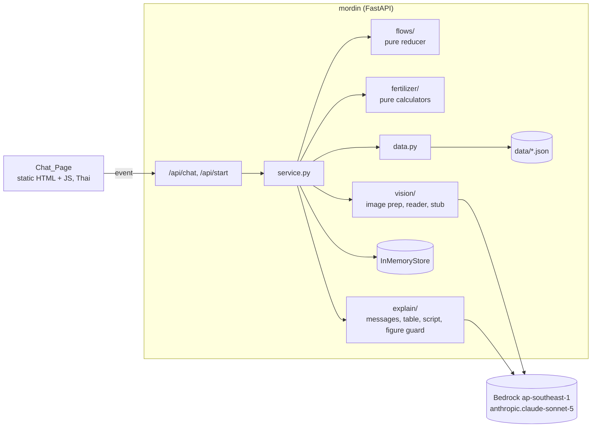
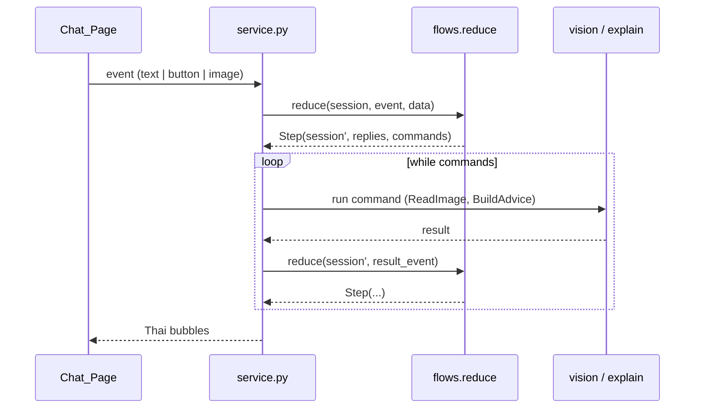
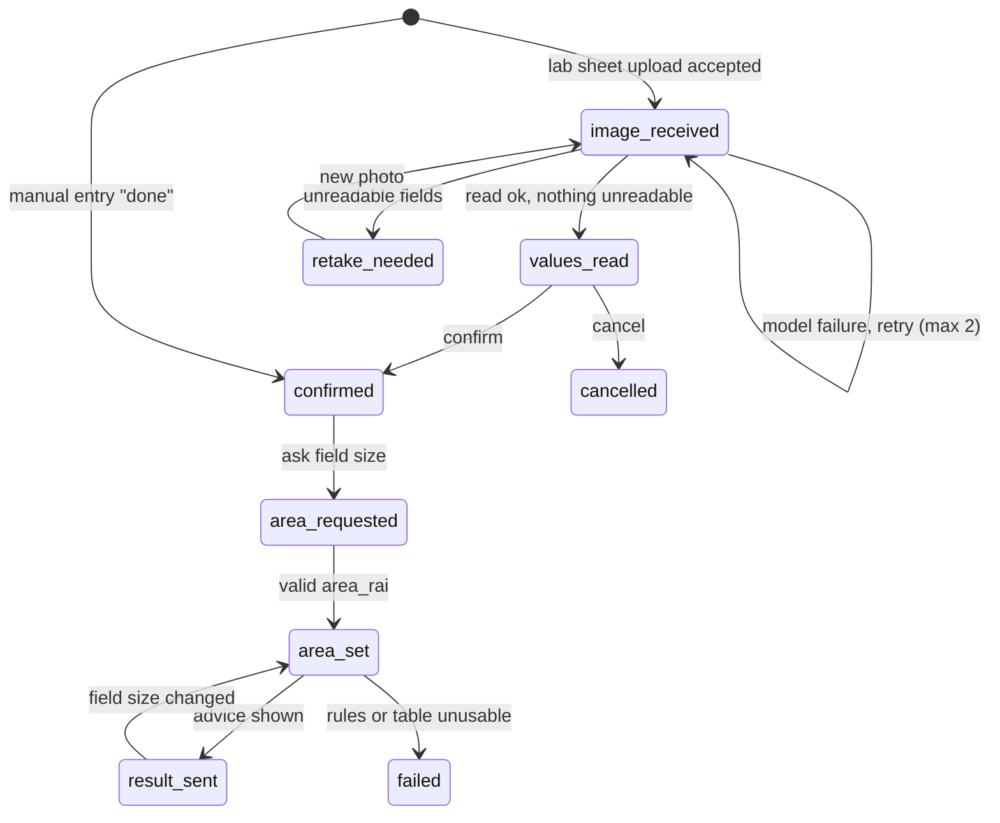

# Design Document (3-hour hackathon build)

## Overview

This design covers the build that fits a 3-hour window. It keeps the architecture decided earlier and cuts everything that is not on the three main flows. The user interface is **Thai only**.

### In this build

| # | Flow | Steps |
|---|---|---|
| A | Lab sheet upload | upload photo, read values and the sheet's fertilizer rate, farmer confirms, area input, fertilizer table and shop script |
| B | Manual entry, full values | type OM, P, K, Ca, Mg (pH is optional), basic formula, area input, fertilizer table and shop script |
| C | Manual entry, pH only | type pH only, pH class and soil-improvement material from `soil_amendments.json`, area input, amendment table and shop script |

### Optional or removed from this build

| Item | Status | What it means for the code |
|---|---|---|
| pH meter photo upload | Removed | No `read_ph_meter`, no `MeterReading`, no `ph_meter` source. pH comes only from typing. |
| Cane price panel | Removed | No `prices/`, no `data/cane_prices.json`, no menu entry. |
| Usage guide | Removed | No `guide.py`, no menu entry. A short hint line on the page replaces it. |
| English (bilingual) | Removed | `messages.py` holds Thai only. No language detection and no `lang` field. Keep message keys so English can be added later. |
| Interactive chat Q&A | Removed | No `chat.py`, no chat agent, no chat tools. Typed text that does not answer a pending step gets a fixed Thai reply pointing to the two menu buttons. |
| Store failure handling and `FailingStore` | Removed | In-memory store only. A store error is logged and shows one generic Thai error bubble. |
| Hypothesis property tests (P1 to P18) | Removed | See Testing Strategy. |

Anything in `requirements.md` and `tasks.md` that covers the removed items is out of this build. They are not edited yet (see Open Points).

### Four decisions kept from the earlier design

1. **Numbers come from code, words come from models.** Rates, totals, prices, pH classes and rounding live in `fertilizer/` as pure functions. The model reads the sheet image and phrases text. A figure guard rejects any model text that holds a number the code did not produce.
2. **The conversation is a pure reducer.** `flows/` turns an event and a session into a new session, reply specs and commands. It does no I/O. `service.py` runs the commands (Bedrock) and feeds the results back.
3. **One result pipeline.** Flows A, B and C all end as a `Plan` of `PlanItem`s. The table, the script and the explanation read the same `Plan`.
4. **Data files hold every tunable value.** Prices, valid ranges, texture list, basic formula rules and the amendment table are read from `data/`.

### Facts checked against AWS documentation

- Bedrock Converse accepts at most **3.75 MB** and **8000 px** per image, as `bytes` for Claude models. The requirements allow uploads up to 10 MB. The design therefore always re-encodes the image before the call (`vision/image.py`). This also removes EXIF data such as phone GPS position.
- Set the maximum output tokens explicitly on every model call.
- Strands structured output: pass `structured_output_model=<Pydantic model>` and read `result.structured_output`.
- Strands examples use `global.` model IDs. They must not be copied. The model ID and Region come only from `config.py` (`aws.md`).

## Architecture



Layer rules (from `structure.md`):

- `fertilizer/` and `flows/` import no network or AWS code.
- Bedrock calls happen only in `vision/` and `explain/`. Both build their model through `config.make_bedrock_model()`.
- Farmer-facing text exists only in `explain/messages.py`. `flows/` returns message keys, not text.

### Event loop



### Session states



`result_sent` is reachable only from `area_set`, and `area_set` only from `area_requested`. `reduce` rejects any request for a total while `area_rai` is `None`.

## Components and Interfaces

### Package layout (this build)

```
src/mordin/
├── main.py            FastAPI app, routes, run() for `uv run mordin`
├── config.py          model ID, Region, guard, make_bedrock_model()
├── data.py            loads and validates every file under data/
├── service.py         runs commands from flows, step timing, error logs
├── flows/             reduce(), events, commands, reply specs, Session
├── vision/            image.py, schemas.py, reader.py, stub.py
├── fertilizer/        area.py, rounding.py, totals.py, sheet_plan.py, formula.py,
│                      amendments.py, routing.py, plan.py
├── explain/           messages.py (Thai), table.py, script.py, figures.py,
│                      templates.py, advice.py
├── storage/           store.py (SessionStore protocol, InMemoryStore)
└── web/               static/index.html
```

Not created in this build: `prices/`, `line/`, `explain/chat.py`, `explain/guide.py`, `explain/language.py`.

### `config.py`

```python
MODEL_ID = "anthropic.claude-sonnet-5"
REGION = "ap-southeast-1"

def guard(model_id: str, region: str) -> None:
    """Raise ConfigError if region != REGION or model_id starts with 'global.' or 'apac.'."""

def make_bedrock_model(max_tokens: int) -> BedrockModel:
    """Call guard(), then build BedrockModel with explicit max_tokens and a BotocoreConfig
    (connect_timeout=5, read_timeout=20, 2 attempts)."""
```

Initial `max_tokens` (assumption): reader 1024, explainer 1500. `strands` is imported inside `make_bedrock_model`.

### `data.py`

Loads and validates these files. A bad file raises `DataFileError(path, reason)`, shown as a Thai message that names the file.

| File | Content | Used by |
|---|---|---|
| `data/fertilizer_prices.json` | `date`, `label`, `prices_per_kg` keyed by fertilizer or material | Totals, advice |
| `data/soil_amendments.json` | `label`, `placeholder`, class limits, `materials` per class with `rate_kg_per_rai` and `max_rate_kg_per_rai` | Flow C |
| `data/dld_rules/basic_formula.json` | `label`, `placeholder`, `required_fields`, status bands, nutrient targets per band, `max_kg_per_rai`, `p_sufficient` | Flow B, soil summary |
| `data/limits.json` | valid ranges per field, texture list, plausible sheet rate maximum, `small_bag_kg` | Validation, small-bag guide |

Checks on load: every target table is monotone (a higher soil level never raises a target), `max_kg_per_rai` exists for urea, dap and mop, and a `placeholder: true` file has a non-empty label. Seed numbers are clearly fake demo values written with the label.

`required_fields` in the basic formula file is set to `om`, `p`, `k`, `ca`, `mg` for this build. The manual entry form shows all six fields (OM, P, K, Ca, Mg, pH), and only pH is optional. The formula itself uses OM, P and K. Ca and Mg are required so the soil summary can cover them. (`requirements.md` A11 lists only `om`, `p`, `k`. See Open Points.)

### `vision/`

- **`image.py` `prepare_image(data) -> PreparedImage`**: checks JPEG or PNG by magic bytes, applies EXIF orientation, re-encodes with Pillow so metadata is dropped, and downscales to at most 2560 px and 3.5 MB when needed (JPEG quality 85, lowered in steps). The numbers are an assumption to confirm on real photos.
- **`schemas.py`**: `SheetItem(fertilizer, rate_kg_per_rai)` and `SheetReading` (om, p, k, ca, mg, ph, soil_texture, `sheet_recommendations`, `reason_code`). Each value is a number or `"unreadable"`. `validate_reading()` marks values outside the valid range, and unknown textures, as `"unreadable"`.
- **`reader.py` `read_lab_sheet(img, data) -> SheetReading`**: a fresh Strands `Agent` per call with `prompts/read_lab_sheet_v1.md`, an image content block, `structured_output_model=SheetReading`, and a 20-second deadline. The prompt asks only for printed values and the sheet's formula and rate. It holds no arithmetic and no instruction to adjust a rate.
- **`stub.py`**: same function from fixtures. Chosen by the upload file name stem if it matches a fixture, else by the default in settings. Enabled by `MORDIN_VISION_STUB=1`. It makes no Bedrock call. It is used for tests and offline demos. The app calls Bedrock by default.

### `fertilizer/` (pure, no network)

All amounts use `Decimal` with half-up rounding.

| Module | Function | Behavior |
|---|---|---|
| `area.py` | `parse_area(text)` | Rai, ngan, square wa, square metre and hectare, alone or combined. A lone number is rai. Raises `AreaError` for zero, negative, non-number, repeated or unknown units. 4 decimals. |
| `totals.py` | `compute_item(rate, area_rai, price_per_kg, limits)` | `total_kg` (0.1 kg), `total_price_thb` (whole baht or `None`), `script_kg` (whole kg), `rate_small_bags_per_rai` (nearest half bag, 0.25 rounds up, small bag 5 kg). |
| `sheet_plan.py` | `build_sheet_plan(recs, area, prices, limits)` | One `PlanItem` per confirmed item. Rate passes through unchanged. No Demo_Rules. |
| `formula.py` | `calculate_basic(values, rules)`, `soil_status(values, rules)` | Table-driven (below). Status is good, fair, low or needs_action per value, including texture. |
| `amendments.py` | `classify_ph(ph, table)`, `build_ph_plan(ph, area, table, prices, limits)` | acidic, balanced or alkaline from the table limits. Material and rate from the table. Then totals. |
| `routing.py` | `choose_path(session)` | `sheet`, `basic_formula`, `ph_only`, or `NeedMoreValues(missing)`. |
| `plan.py` | `Plan`, `PlanItem` | Shared by all paths. |

**Basic formula (placeholder rules)**

1. Find the band of `om`, `p` and `k`.
2. Take the nutrient targets of those bands: N from `om`, P2O5 from `p`, K2O from `k`.
3. `dap = p2o5_target / 0.46`. `urea = max(0, n_target − dap × 0.18) / 0.46`. `mop = k2o_target / 0.60`.
4. Round each to 1 kg (half up) and clamp to `[0, max_kg_per_rai]`. Compute the supplied N, P2O5 and K2O from the rounded amounts, to 0.1 kg.

When `p` is at or above `p_sufficient`, the P2O5 target is 0 and DAP is 0.

**Path choice** (`routing.py`):

- Lab sheet with confirmed recommendations: `sheet`.
- Manual with every required field (pH may be missing): `basic_formula`.
- Manual with only `ph`: `ph_only`.
- Manual with some values but not enough: `NeedMoreValues`. If `ph` is present, the farmer may press a button to continue with pH-only advice.

### `flows/` (pure reducer)

```python
class Session(BaseModel):
    id: str
    state: State
    source: Literal["lab_sheet", "manual"] | None
    values: dict[str, float | str | None]
    sheet_recommendations: list[SheetItem]
    area_rai: Decimal | None
    reads_failed_in_a_row: int = 0
    vision_retries: int = 0
    pending: Pending | None     # what the next typed text answers
    # No image bytes. No farmer name or contact data.

def reduce(session, event, data) -> Step
```

- **Events:** `Text`, `Button(action, payload)`, `ImageUploaded(filename)`, `ReadSucceeded`, `ReadFailed`, `Explained`, `ExplainFailed`.
- **Commands:** `ReadImage`, `BuildAdvice`.
- **Pending:** `AreaAnswer`, `CorrectionTarget`, `CorrectionValue(field)`, `ManualValues`, or `None`. With `None`, typed text gets the fixed "please choose a button" reply. The restart command ("เริ่มใหม่") is checked first.
- **Replies** are specs, such as `Reply(key="retake.message", params={...}, buttons=[...])`. They hold no Thai text.

Handled in `reduce`: upload accepted, read ok or failed (2 retries), retake with the manual-entry button after 2 failures in a row, not-a-DLD-sheet reply, confirm, correct (one value at a time, 3 invalid in a row), rate warning, cancel, restart, manual entry (validate, echo, "done", missing-fields message, pH-only button), area question and parsing (3 misses add restart and cancel), `BuildAdvice`, `result_sent`, and a changed field size.

### `explain/`

| Module | Responsibility |
|---|---|
| `messages.py` | `TH` dict keyed by reply key, fixed item descriptions, retake tips, accuracy notices, the field size question, and `render(reply)`. A test checks that every key used in `flows/` exists. |
| `table.py` | `build_table(plan)` returns the `SummaryTable`: 5 columns (name, kg/rai, total kg, estimated total price in THB, description), the `area_rai` heading, a total row, and a plain-text copy. A row with no price shows "ไม่มีราคา". |
| `script.py` | `ScriptDraft(sentences: list[str])` (max 3), `check_script(draft, plan)`, `template_script(plan)`. |
| `figures.py` | `check_figures(text, allowed)`. A figure is a number next to a weight, money, area or bag unit. |
| `templates.py` | Template soil summary, expected effect, per-rai guide line, notices. |
| `advice.py` | `build_advice(plan, session, data)`. |

**Advice assembly.**

| Block | Source |
|---|---|
| Demo label (flows B and C) | code, from the data file label |
| Summary_Table, price note and date | code |
| Per-rai guide ("ถ้าปุ๋ยถุงละ 5 กก. ใช้หว่านประมาณ 4 ถุงต่อ 1 ไร่ (ประมาณ 20.98 กก.)") | code, from `rate_small_bags_per_rai` and `rate_kg_per_rai` |
| Soil summary, expected effect, shop script | one model call, template fallback per block |
| Guide notice, "values come from demo data" (stub) | code |

One structured call returns `AdviceText(soil_summary, expected_effect, shop_script: list[str])`. The input holds the soil statuses and the allowed figures (`script_kg` per item and `area_rai`). One 10-second deadline covers the step.

- `shop_script`: run `check_script` (at most 3 sentences, every `script_kg` and `area_rai` present, no bag figure, no other figure with a unit). On a problem, retry once if time remains, else use `template_script`.
- `soil_summary` and `expected_effect`: run `check_figures` (these blocks carry no figure with a unit) and a wording check (no "verified", "guaranteed", no yield number). On a problem, use the template block.
- On timeout or model error: all three blocks use templates. One log entry.

### `service.py`

Runs the event loop. It owns the calls to `vision.reader` (after `prepare_image`) and `explain.advice`, each with its deadline, and an `ImageHolder` (in-memory dict by session id) that keeps the prepared image while a retry is possible. Bytes never enter the session store. It deletes them on success, cancel, restart or failure. It counts read retries (max 2) and maps errors to events. It times read, area and explain steps and writes one log line with the total. It writes one error log entry per failure with the failure type, session id and step name, and never a soil value or image data.

### `storage/store.py`

```python
class SessionStore(Protocol):
    def create(self, s: Session) -> None
    def get(self, session_id: str) -> Session
    def save(self, s: Session) -> None
    def delete(self, session_id: str) -> None

class InMemoryStore: ...     # dict
```

### HTTP API (`main.py`)

| Route | Purpose |
|---|---|
| `POST /api/start` | Starts a session. Returns the startup bubbles (accuracy-not-validated notice and the two menu buttons). |
| `POST /api/chat` | Multipart form: `session_id`, and one of `text`, `action` (+ `payload`), or `image`. Returns `{state, bubbles[]}`. |
| `GET /` | Serves `web/static/index.html`. |

A bubble is `{kind: "text"|"buttons"|"table"|"advice", text, buttons, table}`. Text is already in Thai. Upload checks (empty, not JPEG or PNG by magic bytes, over 10 MB) run in the route before any session is created.

### Web page (UI spec)

The page looks and feels like a LINE chat on a phone. It is built mobile first. One static HTML file with vanilla JavaScript and no external fonts or libraries, so it works offline. Every color and size below is a CSS variable at the top of the file, so one edit changes the look.

The colors are close to LINE's look. They are design choices, not copies of LINE's assets.

**Layout (phone, portrait).** The page is one column, at most 480 px wide. On a wider screen the column is centered on a gray page background.

```
┌──────────────────────────────────┐
│ (ดิน) หมอดิน AI      [ข้อมูลตัวอย่าง] │  header, white
├──────────────────────────────────┤
│  ┌────────────────────────────┐  │  chat area, light blue-gray
│  │ ข้อมูลในเดโมนี้เป็นตัวอย่าง    │  │  note card (yellow)
│  └────────────────────────────┘  │
│ (ดิน) ┌───────────────────────┐   │  bot bubble, white, left
│       │ ค่าที่อ่านได้ ...        │   │
│       └───────────────────────┘   │
│       [ ยืนยัน ]                  │  stacked full-width buttons
│       [ แก้ไข ]                   │
│       [ ยกเลิก ]                  │
│            ┌────────────────────┐ │  user bubble, green, right
│            │ (รูปย่อ) ใบตรวจดิน    │ │
│            └────────────────────┘ │
│ (ดิน) ┌───────────────────────┐   │  result: one card per fertilizer
│       │ ยูเรีย 46-0-0          │   │
│       │ ต่อไร่ 20.98 กก.        │   │
│       │ รวม 104.9 กก.          │   │
│       │ ราคาโดยประมาณ 2,098 บาท │   │
│       └───────────────────────┘   │
├──────────────────────────────────┤
│ [📷 อัปโหลดใบตรวจดิน] [✍ พิมพ์ค่าดินเอง] │  menu chips (48 px high)
│ ส่งรูป → ตรวจค่า → บอกขนาดที่ดิน → ได้ตาราง │  hint line
│ [ พิมพ์ข้อความ...        ] [ส่ง]   │  input bar, fixed at the bottom
└──────────────────────────────────┘
```

**Colors**

| Variable | Value | Use |
|---|---|---|
| `--bg-chat` | `#DCE6F2` | chat area background (light blue-gray like LINE) |
| `--bubble-bot` | `#FFFFFF` | bot bubble, header and bottom bars |
| `--bubble-user` | `#9FE69A` | user bubble (light green like LINE) |
| `--text` | `#111111` | all body text on bubbles |
| `--accent` | `#06C755` | LINE green, decoration only (borders, thin accents) |
| `--btn-primary` | `#00873C` | main button background, white text (contrast about 4.8:1) |
| `--btn-secondary` | white with `#00873C` border and text | second button |
| `--btn-tertiary` | white with `#5F6B7A` border and text | cancel |
| `--note-bg` | `#FFF4CC`, text `#5A4500` | demo-data note, warnings |
| `--error` | `#B00020` | error bubble left border and title |

White text sits only on `--btn-primary`, never on `--accent`, which is too light for text.

**Type (medium size)**

| Element | Size |
|---|---|
| Body and bubble text | 17 px, line height 1.6 |
| Buttons | 18 px, bold |
| Header title | 20 px, bold |
| Card item name | 17 px, bold |
| Card figures | 17 px |
| Card description, notices, hint line | 14 to 15 px |

Font stack: `"Sarabun", "Noto Sans Thai", "Leelawadee UI", "Tahoma", sans-serif`. The first two apply only if installed on the phone. No web font is downloaded. The text input is at least 16 px so iPhones do not zoom on focus.

**Components**

| Component | Behavior |
|---|---|
| Header | White bar with a round green avatar (text "ดิน"), the title "หมอดิน AI", and, while the Vision_Stub is on, a small yellow badge "ข้อมูลตัวอย่าง". |
| Bot bubble | White, left, avatar beside the first bubble of a group, max width 82%, radius 18 px with a 4 px corner on the avatar side, padding 10 by 14 px. |
| User bubble | Green, right, same shape. An uploaded photo shows as a small thumbnail made in the browser. It is not stored or sent anywhere else. |
| Buttons in a bot message | Stacked, full width of the bubble, at least 48 px high, 8 px apart. Order: main action (green), second action (outlined), cancel (gray outline). |
| Menu chips | Two chips above the input bar, at least 48 px high. "✍ พิมพ์ค่าดินเอง" appears only when flows B and C are built (task 4.4). |
| Hint line | One line under the chips, 14 px, gray: send the photo, check the values, say the field size, get the table. |
| Input bar | Fixed at the bottom with the safe-area inset. Text field and a 48 px send button. |
| Photo input | `accept="image/jpeg,image/png"` and no `capture` attribute, so the farmer can take a photo or choose one from the gallery. |
| Waiting bubble | Three animated dots with the text "กำลังอ่านค่าจากรูป..." or "กำลังคิดคำแนะนำ...". The menu, buttons and input are disabled while it shows. Animation stops when the phone asks for reduced motion. |
| Error bubble | White with a 4 px `--error` left border and a restart button. |
| Note card | `--note-bg`. Used for the demo-data notice, the Demo_Rules_Label and the rate warning. |

**Result messages (in this order)**

1. Note card with the demo label (flows B and C).
2. Heading "แผนสำหรับ N ไร่", then **one card per Plan_Item**: the item name, kg per rai, total kg, the estimated total price in baht, and the short description. A last card shows the estimated total. A card with no price shows "ไม่มีราคา". The five table columns map to the card lines. The markup stays a semantic table, so the content is still a table for screen readers.
3. Shop script card with the title "ข้อความไปบอกร้านปุ๋ย" and a "คัดลอก" button.
4. A "คัดลอกข้อความตาราง" button that copies the plain-text copy of the table. If the browser blocks copying, the text shows in a read-only box.
5. Per-rai guide lines, then the soil summary and expected effect.
6. Notices in small text: estimated price date, guide notice.

**Accessibility.** `lang="th"`. The chat area has `aria-live="polite"`. All buttons are real `<button>` elements. Text contrast is at least 4.5:1. Nothing relies on color alone.

## Data Models

`Plan` and `PlanItem`:

```python
@dataclass(frozen=True)
class PlanItem:
    key: str                          # "urea", "15-15-15", "agri_lime"
    rate_kg_per_rai: Decimal
    total_kg: Decimal
    total_price_thb: Decimal | None   # None -> "ไม่มีราคา"
    script_kg: int
    rate_small_bags_per_rai: Decimal

@dataclass(frozen=True)
class Plan:
    source: Literal["sheet", "basic_formula", "ph_only"]
    area_rai: Decimal
    items: tuple[PlanItem, ...]
    price_date: str
    uses_demo_rules: bool             # True for basic_formula and ph_only
    ph_class: str | None
    soil_status: dict[str, str]
```

`SummaryTable` holds `heading`, `columns` (5), `rows`, `total_row` and `text_version`, all strings formatted from `Decimal`. `AdviceMessage` holds `demo_label`, `table`, `shop_script` (1 to 3 sentences), `per_rai_guide`, `soil_summary`, `expected_effect` and `notices`.

## Error Handling

| Situation | Handling |
|---|---|
| Upload empty, not JPEG or PNG, or over 10 MB | Reject in the route. No session. Keep the upload button. |
| Model call fails, times out, bad JSON, or `ConfigError` | Retry button and manual-entry button. After 2 retries only the manual button. |
| Unreadable field or reason code | `retake_needed`. The message names what failed and gives photo tips. After 2 in a row also the manual button. |
| Not a DLD sheet | Message with upload and manual buttons. Values discarded. |
| Rate outside the plausible range | Warning on the confirm bubble. Not blocked. |
| Invalid correction or manual value | Ask again with the accepted range. Three misses return to the buttons. |
| Invalid area answer | Ask again with an example. Three misses add restart and cancel. |
| Rules, amendment or price file missing or invalid | `failed`, with a Thai message that names the file. |
| Sheet fertilizer has no price | "ไม่มีราคา" in that row. The total row says it counts only priced items. |
| Explainer fails or breaks a check | Template block. One log entry. |
| Session store error | One log entry and one generic Thai error bubble with a restart button. No special handling per state. |

## Testing Strategy

Only two kinds of test are in this build.

1. **Unit tests for `fertilizer/`** (no network, no credentials, run with `uv run pytest`):
   - `area.py`: "3 ไร่ 2 งาน" gives 3.5, "1 เฮกตาร์" gives 6.25, "5" gives 5. Zero, negative, non-number, repeated and unknown units are rejected.
   - `totals.py`: 104.9 kg gives `script_kg` 105, 60.0 gives 60. 20.98 kg per rai gives 4 small bags, 12 gives 2.5, 1 gives 0. A grade with no price gives `None`.
   - `sheet_plan.py`: each rate passes through unchanged. Doubling `area_rai` doubles the unrounded total.
   - `formula.py`: the three fixtures give the expected urea, DAP and MOP. The same input gives the same output. Every amount stays within `[0, max]`. `p` at or above `p_sufficient` gives DAP 0. A hand-picked pair with P raised gives DAP not higher. `soil_status` for each fixture.
   - `amendments.py`: acidic, balanced and alkaline fixtures. Balanced gives no material. A class with no material in the table gives no item. Totals for `area_rai`. A missing or invalid table raises the data error.
   - `routing.py`: lab sheet, full values, pH only, and not enough values.
2. **One end-to-end integration test** (`TestClient`, Vision_Stub, InMemoryStore, template Explainer): lab sheet fixture upload, confirm, field size "5", then assert that the table totals equal rate times 5, the script has at most 3 sentences with the right `script_kg`, and the demo-data label shows.

Flows B and C are covered by the calculator unit tests and by one manual smoke test at the end (type full values, then type only a pH, and check the table and script on the page). The reducer and the model-phrased text are covered by the integration test only. Live Bedrock accuracy is not tested here, and no claim is made about it.

Dependencies: `fastapi`, `uvicorn`, `python-multipart`, `pillow`. Dev: `pytest`, `httpx` (no Hypothesis). `pyproject.toml` needs `[build-system]` for the `src/` layout and `[project.scripts] mordin = "mordin.main:run"`.

## Suggested Order Inside the 3 Hours (estimate)

| Time | Work |
|---|---|
| 0:00 to 0:20 | Project setup, `config.py`, `data/` seed files, `data.py` |
| 0:20 to 0:55 | `fertilizer/` calculators and their unit tests |
| 0:55 to 1:30 | `Session`, store, `reduce()` for flows A, B and C |
| 1:30 to 2:00 | `vision/` (stub first, then image prep and Bedrock reader), `explain/` templates and table |
| 2:00 to 2:30 | `explain/advice.py` with the model call, `service.py`, `main.py`, the page |
| 2:30 to 3:00 | Integration test, manual smoke test of B and C, one live Bedrock check with the stub off |

If time runs short, cut in this order: the Bedrock reader (keep the stub), the model call in `advice.py` (keep templates), the rate warning, then flow C.

## Design Decisions and Open Points

1. **Image re-encoding stays.** The upload limit (10 MB) is above the Bedrock limit (3.75 MB, 8000 px), so the design always re-encodes, which also removes EXIF. The resize numbers are an assumption.
2. **`requirements.md` and `tasks.md` are not trimmed yet.** They still describe the removed items (Requirements 14 to 17 and 19, the pH meter parts of 2, 3 and 10, and the property tests in 23). Edit them to match, or mark those items "out of this build".
3. **Required fields for the basic formula are `om`, `p`, `k`, `ca`, `mg`. pH is optional.** I read "show all fields, pH optional" this way. If you meant that Ca and Mg may also be skipped, change `required_fields` to `om`, `p`, `k`, which is also what `requirements.md` A11 says. It is one line in `data/dld_rules/basic_formula.json`. A farmer who types only OM, P and K then gets a "missing Ca and Mg" message instead of a result.
4. **Typed text outside a pending step** gets a fixed Thai reply. This replaces the chat agent.
5. **`agent.py`** (the terminal demo) is unchanged. It still includes chat, cane prices, usage guide and English, which are not part of this build. Treat it as a separate demo.
6. **Re-adding removed items later** is cheap: English needs a second dict in `messages.py` and a language field. The pH meter needs `MeterReading` and `read_ph_meter`. Cane prices need `prices/` and a data file.
